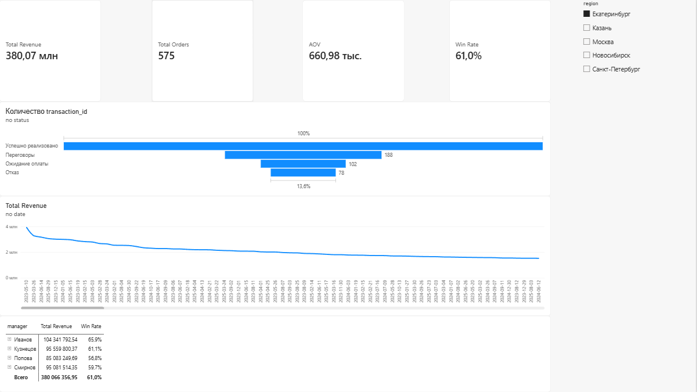
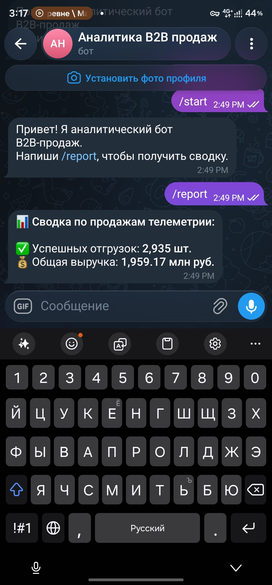

# 📊 B2B Telemetry Sales Analytics & Automated Reporting

## 📌 О проекте (Business Problem)
В сфере оптовых B2B-продаж оборудования (телеметрия, приборы учета) критически важно оперативно отслеживать воронку продаж, контролировать отгрузки и оценивать эффективность менеджеров. 

Цель данного проекта — создание полноценной **End-to-End аналитической экосистемы**, которая автоматизирует сбор данных, нормализует их в реляционную базу и предоставляет бизнесу готовые инсайты через интерактивный дашборд и Telegram-бота.

## 🛠 Технологический стек
*   **Data Engineering / ETL:** Python (Pandas, NumPy)
*   **База данных:** SQLite (проектирование схемы «Звезда», DDL)
*   **Аналитика:** Продвинутый SQL (CTE, оконные функции, агрегации)
*   **Визуализация (BI):** Power BI (DAX-моделирование, настройка ODBC)
*   **Автоматизация:** Python (aiogram, asyncio)

## 🚀 Ключевые возможности проекта

1.  **Генерация и ETL-процесс:** 
    *   Написан Python-скрипт для генерации реалистичного датасета (5000+ записей) B2B-транзакций.
    *   Реализован пайплайн очистки и нормализации плоского CSV-файла в реляционную БД (выделение таблиц фактов `fact_sales` и измерений `dim_clients`, `dim_managers`, `dim_products`).
2.  **Интерактивный дашборд (Power BI):**
    *   Настроено прямое подключение к SQLite через ODBC.
    *   Написаны DAX-меры для расчета ключевых коммерческих KPI: **Total Revenue, AOV (Средний чек), Win Rate (% успеха), Total Orders**.
    *   Визуализирована сезонность продаж, воронка конверсии и матрица эффективности менеджеров по категориям товаров.
3.  **Telegram-бот для утренней отчетности:**
    *   Асинхронный бот на `aiogram`, который напрямую обращается к SQL-базе.
    *   По команде `/report` формирует и отправляет агрегированную сводку по ключевым показателям выручки и успешным отгрузкам.

## 📁 Структура репозитория

```text
├── data/
│   ├── raw_data_generator.py      # Скрипт генерации синтетических данных продаж
│   └── etl_pipeline.ipynb         # Ноутбук с процессом нормализации и загрузки в БД
├── sql/
│   └── analytical_views.sql       # SQL-запросы (расчет долей продаж и ранжирование)
├── bot/
│   └── main_bot.py                # Исходный код Telegram-бота (aiogram)
├── dashboards/
│   ├── sales_dashboard.pbix       # Исходник дашборда Power BI
│   └── dashboard_preview.png      # Скриншот дашборда для превью
├── README.md                      # Описание проекта
└── b2b_telemetry.db               # (Игнорируется в .gitignore) Локальная БД
```

## 📸 Демонстрация работы

### Power BI Дашборд


### Telegram-бот


## ⚙️ Как запустить проект локально

1. **Клонируйте репозиторий:**
```bash
git clone https://github.com/ВАШ_НИК/b2b-telemetry-analytics.git
```

2. **Установите зависимости Python:**
```bash
pip install pandas numpy aiogram nest_asyncio
```

3. **Сгенерируйте данные и базу данных:**
   * Запустите скрипт `raw_data_generator.py` для создания CSV-файла.
   * Выполните ячейки в `etl_pipeline.ipynb`, чтобы создать `b2b_telemetry.db`.

4. **Запустите бота:**
   * Вставьте свой Telegram API токен в файл `main_bot.py` (вместо 'YOUR_TOKEN_HERE').
   * Выполните `python bot/main_bot.py`.

5. **Просмотр дашборда:**
   * Установите драйвер [SQLite ODBC](http://www.ch-werner.de/sqliteodbc/).
   * Откройте файл `sales_dashboard.pbix` в Power BI Desktop и обновите источники данных.
